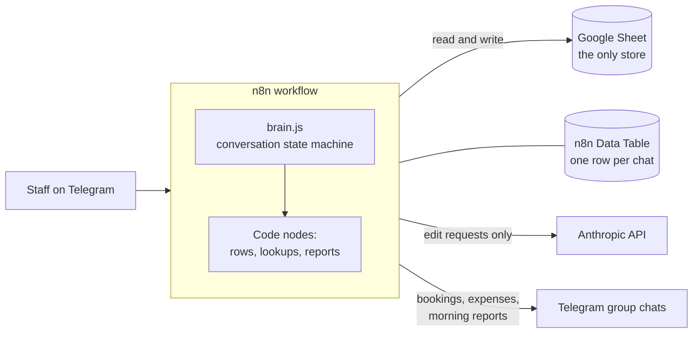

# hostel-bookings-bot

A Telegram bot that runs bookings and expenses for the hostel. Staff use it in
Arabic. It reads and writes one Google Sheet, which is the only store: since
2026-10-12 the bot no longer touches a database.



## What's in the repo

| Folder | What it is | Status |
|---|---|---|
| [`booking_bot/`](booking_bot/) | The n8n workflow: `brain.js` is the conversation state machine, `nodes/` holds the other Code nodes (including the ones that read the sheet), and `build_workflow.py` generates the importable graph. | **Live** |
| [`supabase/`](supabase/) | Postgres schema, migrations, the sheet backfill, and the mirror and reconcile scripts. | **Retired 2026-10-12.** The bot no longer reads or writes it |
| [`webui/`](webui/) | A Next.js 15 dashboard for bookings, expenses, deposits, reports and reconcile. It connects to Postgres directly. | **Retired 2026-10-12.** Its data is no longer updated |
| [`python_version/`](python_version/) | The original python-telegram-bot implementation. | **Retired.** Kept for reference only |
| [`docs/`](docs/) | Plans and the running handoff log (`HANDOFF.md`). | — |

Each folder has its own README with the details.

## What the bot does

- **Admins** get the full menu: new booking (حجز), expense (مصروف), and edit
  booking (تعديل حجز).
- **Cashiers** get expense (مصروف) and add a payment (إضافة مبلغ مدفوع). Adding a
  payment shows what the booking has paid against its price, asks for a receipt
  for انستاباي and فودافون كاش, and saves nothing until the review card is
  confirmed.
- **Admins** also get 🤖 تعديل بالذكاء الاصطناعي: type a change to a booking in
  plain words, see exactly what would change, and confirm. The model only reads
  the text; the same code path as the edit menu writes it.
- Every booking is posted to the group chat. The bot suggests the next booking
  ID, and the numbering restarts each Cairo calendar month.
- In column P (المتبقي) the bot writes the sheet's own formula, not a number,
  so the remaining balance keeps tracking price minus paid.
- Morning reports cover occupancy, free rooms and debt grouped by apartment.

Access is controlled by `ADMIN_USERS` and `CASHIER_USERS` on the workflow's
Config node. `brain.js` carries the same lists as defaults.

## Working on the bot

Edit the source in `booking_bot/`. Never edit the graph in the n8n editor: the
graph is generated from this repo, and changes made in the editor are lost on
the next build.

```bash
node booking_bot/test_brain.mjs          # state machine, offline
node booking_bot/test_reports.mjs        # report builders, offline
node booking_bot/test_sheet_lookup.mjs   # the sheet lookups, offline
python -m pytest booking_bot             # generator, migration, validator
python booking_bot/build_workflow.py     # regenerate the workflow JSON
python booking_bot/validate_workflow.py  # check connections in the JSON

python booking_bot/push_brain.py --check    # can we reach the live n8n?
python booking_bot/push_brain.py --publish  # deploy brain.js + access lists
python booking_bot/deploy_graph.py --publish
```

[`booking_bot/README.md`](booking_bot/README.md) covers deployment, rebuilding
into a fresh n8n instance, and the manual import path.

## Web dashboard (retired)

The dashboard and its Supabase database are no longer part of the system: the
admin edits the sheet by hand, so the database could not stay current, and a
bot that read it wrote payments onto the wrong guest's row. The code is kept
for reference only. Nothing here updates it, and nothing in it affects the bot.

## Secrets

These files are gitignored and must never be committed: `.env`,
`service_account.json`, and `backups/`. Backups contain the bot token and guest
names and phone numbers. `.env.example` lists the variables the retired Python
bot used. The n8n workflow keeps its own settings on its Config node.

## Tech stack

- **Live bot:** n8n (Telegram Trigger, Google Sheets and Code nodes, a Data Table for
  sessions), with the conversation logic in plain JavaScript (`booking_bot/brain.js`)
  and the Anthropic API for the optional AI edit.
- **Tooling:** Python 3 scripts that generate, validate and deploy the workflow; Node
  scripts for the offline tests.
- **Retired:** a Next.js 15 dashboard on Postgres (Supabase), and a python-telegram-bot
  version with gspread.

## Testing and CI

Everything runs offline: no Telegram, Google or n8n access is needed.

```bash
node booking_bot/test_brain.mjs && node booking_bot/test_rows.mjs
node booking_bot/test_reports.mjs && node booking_bot/test_sheet_lookup.mjs
pip install -r python_version/requirements.txt "psycopg[binary]"
python -m pytest booking_bot supabase python_version/tests
cd webui && npm ci && npm run build && node --test lib/mirror.test.mjs
```

CI runs all of these on every pull request and on pushes to `main`.

## Security notes

- Only Telegram users on the admin or cashier list get a conversation; anyone else
  gets one refusal to a command and silence otherwise. Admins and cashiers see
  different menus, and each flow checks the role again.
- The AI edit only reads the typed text. The change is shown for confirmation and
  written by the same code path as the edit menu.
- The retired dashboard signs its session cookie with HMAC-SHA256 and compares
  signatures in constant time; it refuses everyone when `DASHBOARD_PASSWORD` is unset.
- See [SECURITY.md](SECURITY.md) to report a vulnerability.

## Author

Built by Ahmed Ibrahim Hussien ([a-3isa](https://github.com/a-3isa)). No licence file:
all rights reserved.
